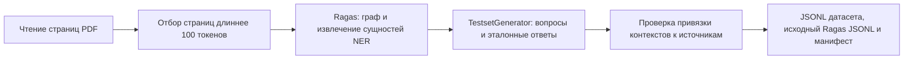
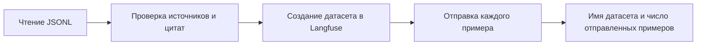
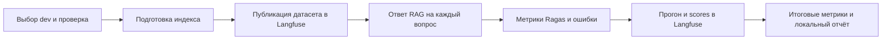
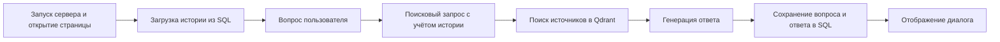
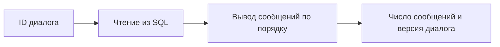

# RAG Chat

Команды выполняются из корня проекта с настроенным `.env`. Для Langfuse укажите `LANGFUSE_ENABLED=true`, `LANGFUSE_PUBLIC_KEY`, `LANGFUSE_SECRET_KEY` и `LANGFUSE_BASE_URL`.

Генерация датасета из PDF в `data/knowledge` библиотекой Ragas (`TestsetGenerator`, 10 вопросов с эталонными ответами):

```powershell
uv run rag-chat dataset-generate --output data/eval/pdf_ragas_draft.jsonl --testset-size 10
```

Генерация вызывает API модели из `.env`. Файл `pdf_ragas_draft.jsonl` уже существует: для нового прогона задайте другое имя, например `pdf_ragas_draft_v2.jsonl`, и используйте его в командах загрузки и оценки. Результат — непроверенный черновик.

Загрузка датасета в Langfuse:

```powershell
uv run rag-chat dataset-push --dataset data/eval/pdf_ragas_draft.jsonl --allow-unreviewed
```

Оценка датасета с отправкой результатов в Langfuse (все примеры части `dev`):

```powershell
uv run rag-chat evaluate --dataset data/eval/pdf_ragas_draft.jsonl --allow-unreviewed --split dev --limit 0
```

Запуск чата в Streamlit:

```powershell
uv run streamlit run app.py
```

Просмотр истории по ID диалога (замените `UUID_ДИАЛОГА` своим ID):

```powershell
uv run rag-chat history --session UUID_ДИАЛОГА
```

Логи выводятся в тот же терминал: время, этап и его результат. Для Streamlit логи приложения появляются после открытия страницы в браузере.

## Схемы этапов

**Генерация датасета через Ragas**



В терминале: число прочитанных и выбранных страниц, начало генерации, фактическое число примеров и пути трёх файлов. Реализация: `src/rag_lab/ragas_generation.py`, функция `generate_ragas_dataset`.

**Загрузка датасета**



В терминале: число прочитанных примеров, результат проверки, ID каждого отправленного примера и итоговое имя датасета.

**Оценка датасета**



В терминале: ID прогона, результат индексации, ответы, оценки и ошибки каждого примера, ссылка на прогон, средние метрики и путь к `report.md`. При отключённом Langfuse явно выводится пропуск публикации.

**Чат в Streamlit**



В терминале: готовность приложения, ID диалога, число сообщений, поисковый запрос, найденные источники, текст ответа, время ответа, trace ID и результат сохранения.

**Просмотр истории**



В терминале: сообщения `user` / `assistant` и итоговый счётчик. Если ID не найден — ошибка и код завершения `1`. RAG и LLM не запускаются.
